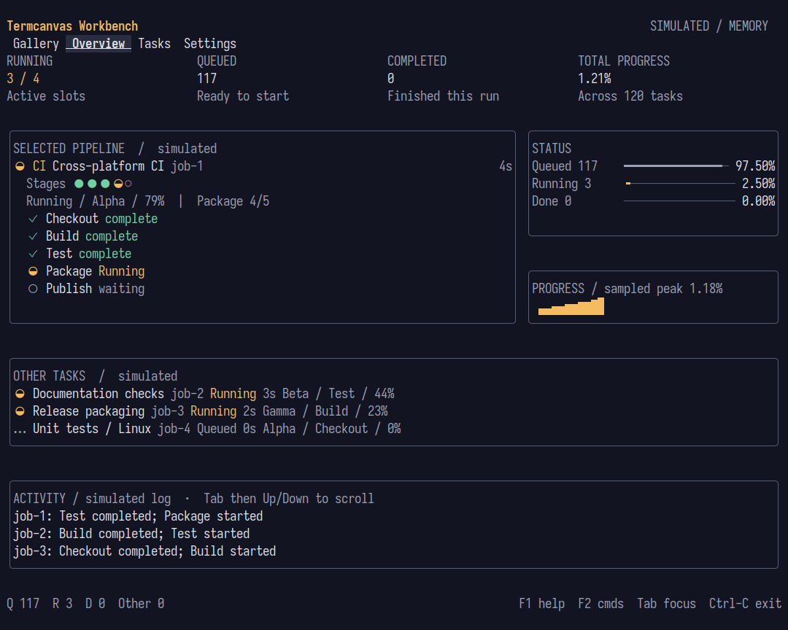
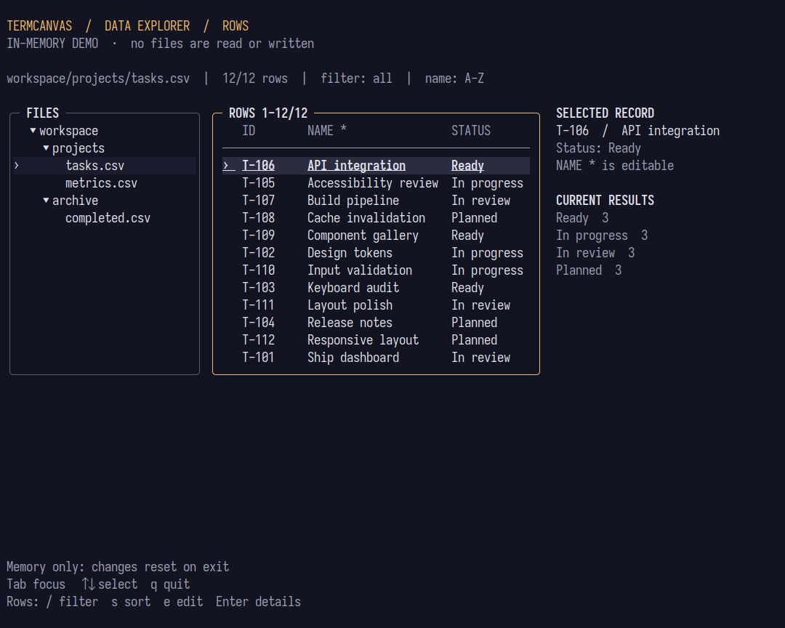
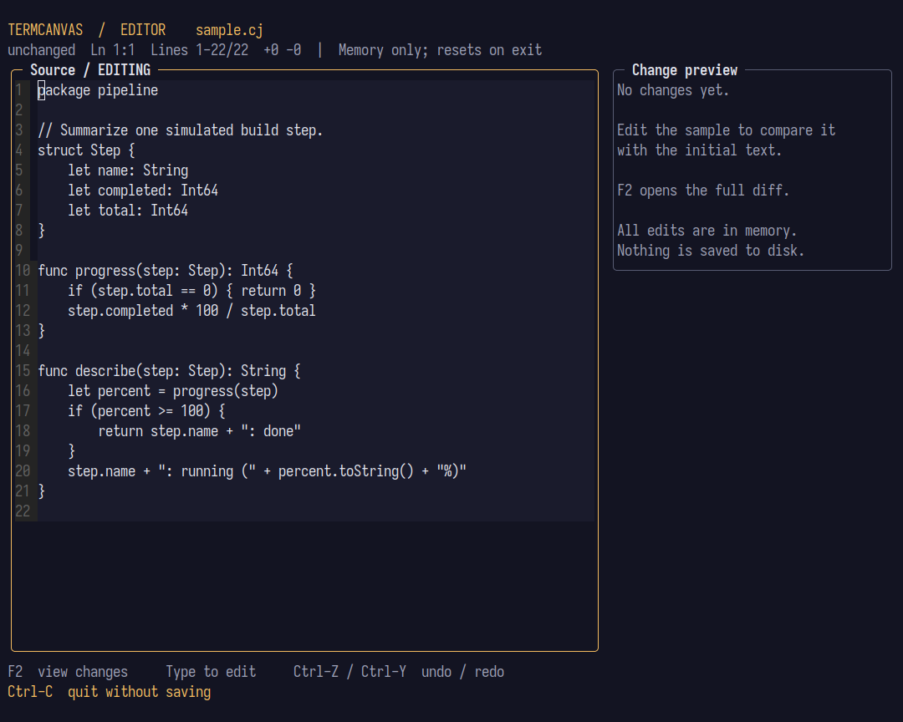
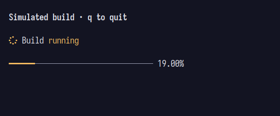

# termcanvas

用 Cangjie 构建终端应用：从任务状态和表单，到可交互的数据工作台。

[快速开始](#快速开始) · [运行示例](#运行示例) · [组件与扩展](#组件与扩展) · [文档](#文档)


上图是离线运行的 CI 工作台示例。任务、日志和进度均为模拟数据；它展示了如何将 `core` 中的布局、主题和组件组合成完整应用。



图片来自 Linux 上运行的终端应用；尺寸、字体、构建摘要和验证范围见[采集记录](docs/assets/capture-provenance.json)。

## 运行示例

先检出本仓库，准备 Cangjie STS 1.2.0，并将 `CANGJIE_SDK_ROOT` 指向 SDK 目录。从仓库根目录运行：

```bash
export CANGJIE_SDK_ROOT=/path/to/cangjie
scripts/cangjie_cmd.sh examples/workbench cjpm run -- --ci
```

工作台中的 `F3` 切换页面，`Tab` 切换焦点，`F1` 打开帮助，`Ctrl-C` 退出。不带 `--ci` 参数启动 Workbench 会进入组件 Gallery。

[CI 任务活动示例](examples/ci_activity/README.md)展示另一种任务视图；原有的 [CI 截图记录](examples/ci_activity/screenshots/ci-showcase-capture-manifest.json)和 [Workbench 截图记录](examples/workbench/screenshots/showcase-capture-manifest.json)也可查阅。

另外两个示例同样只使用内存中的数据，不会读写用户文件：

```bash
scripts/cangjie_cmd.sh examples/showcase_data cjpm run
scripts/cangjie_cmd.sh examples/showcase_editor cjpm run
```

| 数据浏览器：文件树、筛选、排序和编辑 | 编辑器：编辑与差异视图 |
| --- | --- |
|  |  |

数据浏览器使用 `Tab` 切换焦点，`q` 退出；编辑器使用 `F2` 查看差异，`Ctrl-C` 退出。退出后示例中的更改不会保存。

## 快速开始

下面从源码检出创建一个独立的应用包。在仓库根目录创建目录：

```bash
mkdir -p hello-termcanvas/src
```

将以下内容保存为 `hello-termcanvas/cjpm.toml`：

<!-- termcanvas-quickstart-manifest:start -->
```toml
[package]
name = "readme_quickstart"
version = "0.0.1"
cjc-version = "1.2.0"
output-type = "executable"

[dependencies]
"core" = { path = "../packages/core", output-type = "static" }
```
<!-- termcanvas-quickstart-manifest:end -->

将下面的程序保存为 `hello-termcanvas/src/main.cj`。它显示模拟任务和自动更新的进度，按 `q` 或 `Ctrl-C` 退出。

<!-- termcanvas-quickstart:start -->
```cangjie
package readme_quickstart

import core.*

class Demo {
    var value: Int64 = 0
    let theme = Theme.indigo().withIconSet(IconSet.NerdFont)

    func update(event: Event): UpdateResult {
        match (event) {
            case Event.KeyDown(key) => match (key.code) {
                case KeyCode.Char(r'q') | KeyCode.CtrlC => UpdateResult.exit()
                case _ => UpdateResult.next()
            }
            case Event.Tick(_) =>
                value = (value + 5) % 101
                UpdateResult.next()
            case _ => UpdateResult.next()
        }
    }

    func render(frame: Frame): Unit {
        frame.fill(frame.area, theme.canvas)
        frame.canvas().drawText(2, 1, "Simulated build · q to quit", theme.heading)
        frame.renderWidget(TaskActivityView(TaskActivity("Build", status: TaskStatus.Running),
            layout: TaskActivityLayout.Compact, theme: theme), Rect(2, 3, 40, 1))
        frame.renderWidget(ProgressBar(value, total: 100, labelMode: ProgressBarLabelMode.Percent,
            theme: theme), Rect(2, 5, 40, 1))
    }
}

main(): Int64 {
    let demo = Demo()
    App(targetFps: 10).runWithCommands({ frame => demo.render(frame) }, { event => demo.update(event) })
    0
}
```
<!-- termcanvas-quickstart:end -->

```bash
scripts/cangjie_cmd.sh hello-termcanvas cjpm run
```



示例显式选择 `IconSet.NerdFont`；终端还需要安装并选用包含相应字形的 Nerd Font。若不使用 Nerd Font，将其改为 `IconSet.Unicode`；需要 ASCII 时使用 `IconSet.Ascii`。设置图标集不会替终端安装字体。

## 组件与扩展

应用持有状态，在 `App` 的更新循环中处理 `Event`，再以 `Widget` 将当前状态绘制到 `Frame`。`core` 包提供任务活动、进度条、表单、列表、表格、树、弹窗、文本编辑、布局和主题；应用也可以直接使用 `Canvas` 与 `Buffer` 绘制。

主题为画布、文字、边框和交互状态提供语义样式；组件可以使用应用主题或显式指定自己的主题。`StyledWidget` 支持逐属性覆盖组件写入的单元格样式。更多控件及其状态可在 [Workbench 控件图集](docs/gallery.md) 中查看。

下面是 Workbench 的代码片段；`app`、`frame` 和 `layout` 由示例应用提供。它们展示组件的组合方式，完整应用包含状态、事件处理和布局。

<details>
<summary>导航：页面标签</summary>

Workbench 根据应用状态设置当前页面和焦点，再绘制标签栏。完整上下文见 [Workbench 视图](examples/workbench/src/view.cj)。

```cangjie
let pageTabs = Tabs(["Gallery", "Overview", "Tasks", "Settings"], selected: app.tabs.selected)
pageTabs.setTheme(Some(app.theme))
pageTabs.setFocused(app.focus.isFocused("tabs"))
frame.renderWidget(pageTabs, layout.tabs)
```

</details>

<details>
<summary>表单：输入框和按钮</summary>

任务编辑器为输入框设置焦点和错误状态；任务页根据当前选择启用或禁用操作。完整上下文见 [Workbench 视图](examples/workbench/src/view.cj)。

```cangjie
app.editorName.setVisualState(focused: app.interaction.focus().isFocused("editor-name"),
    error: !app.editorError.isEmpty(), theme: Some(app.theme))
frame.renderWidget(app.editorName, layout.editorName)
```

```cangjie
frame.renderWidget(Button("Run", focused: app.focus.isFocused("task-run"), disabled: !app.canRun(),
    style: app.theme.normal, focusedStyle: app.selectedStyle(), disabledStyle: app.theme.disabled), layout.taskRun)
```

</details>

<details>
<summary>数据：可选中的任务表</summary>

表格使用应用持有的行数据和选择状态。完整上下文见 [Workbench 视图](examples/workbench/src/view.cj)。

```cangjie
let table = Table(["ID", "Name", "Project", "Status", "Progress"], app.taskRows(options),
    widths: app.layoutTableWidths(), state: Some(app.taskState), style: app.theme.normal,
    headerStyle: app.theme.accent, selectedStyle: app.selectedStyle(), selectionMarker: selectionMarker)
frame.renderWidget(table, layout.taskTable)
```

</details>

<details>
<summary>反馈：进度与通知</summary>

任务概览用 `ProgressBar` 显示带百分比的状态分布；通知由应用加入并更新。完整上下文见 [Workbench 视图](examples/workbench/src/view.cj)和[状态与事件处理](examples/workbench/src/workbench.cj)。

```cangjie
frame.renderWidget(ProgressBar(value, total: total, style: app.borderStyle, fillStyle: fillStyle,
    labelMode: ProgressBarLabelMode.Percent, labelStyle: app.theme.normal),
    Rect(area.x + labelWidth, area.y, max(0, area.width - labelWidth), 1))
```

```cangjie
toastItems.add(Toast(message, kind: Some(kind), ttl: 3))
toastAges.add(0)
rebuildToastManager()
```

</details>

| 包 | 用途 |
| --- | --- |
| [`core`](packages/core/) | 运行时、终端会话、布局、组件、主题与编辑原语 |
| [`markdown_adapter`](packages/markdown_adapter/) | 将 Markdown 解析结果转换为富文档 |
| [`terminal`](packages/terminal/) | ANSI 输出解析、终端转录和视图 |
| [`diff`](packages/diff/) | 统一 diff 解析和视图 |
| [`media`](packages/media/) | 图片协议和文本回退 |
| [`game`](packages/game/) | 游戏相关数据结构和绘制能力 |
| [`testing`](packages/testing/) | 下游应用的测试工具 |

## 平台与终端

| 环境 | 当前范围 |
| --- | --- |
| Linux/glibc | 主要开发与验证目标；发布验证使用 Cangjie STS 1.2.0。 |
| macOS、Windows | 有原生 CI 测试路径；适配器仍属实验支持，具体结果以对应运行记录为准。 |
| 色彩与字形 | 支持终端能力适配、Unicode 和 ASCII 回退；Nerd Font 字形取决于终端实际使用的字体。 |

Linux 和 macOS 构建需要 `cc` 与 `ar`；Windows 无需 C 编译器。Windows 默认 waiter 支持提供 `waitHandle()` 的 `EventSource`，仅有 POSIX 文件描述符的 source 需要自定义 waiter。`TerminalSession` 负责恢复终端模式；raw mode 失败时可检查 `rawModeEnabled` 和 `TerminalMode.lastError()`。终端显示还取决于字体、宽度设置和终端能力。详见[平台支持](docs/platforms.md)和[限制](docs/limitations.md)。

## 文档

- [快速开始](docs/getting-started.md)、[示例目录](docs/examples.md)、[API 总览](docs/api.md)
- [应用运行时](docs/app-runtime.md)、[组件](docs/widgets.md)、[布局](docs/layout.md)、[事件](docs/events.md)
- [扩展](docs/extensions.md)、[测试](docs/testing.md)、[版本与兼容性](docs/versioning.md)

项目处于 pre-1.0 阶段；公开 API 的稳定性分级和兼容策略见[版本与兼容性](docs/versioning.md)。

## 许可证

[Apache License 2.0](LICENSE)
